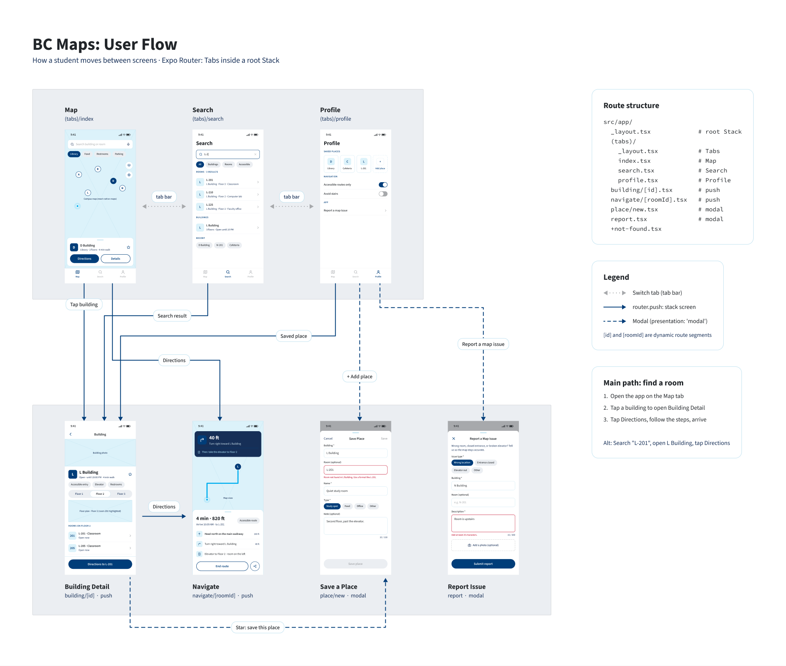
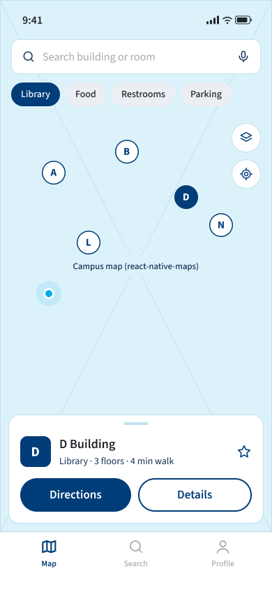
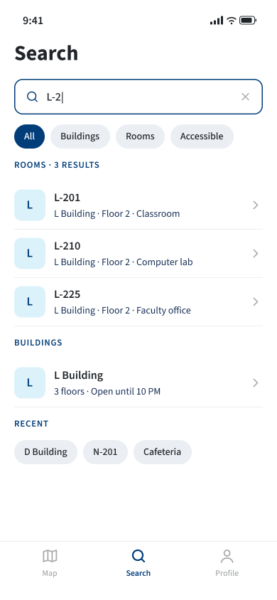
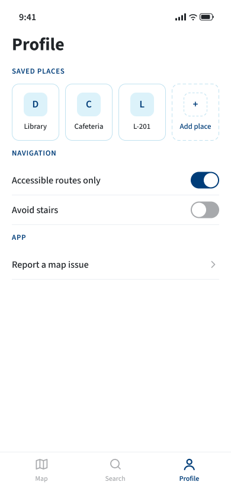
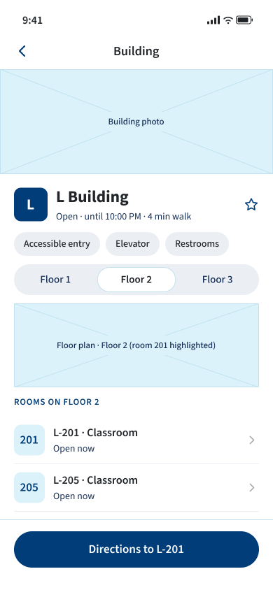
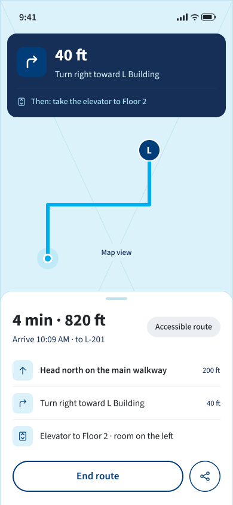
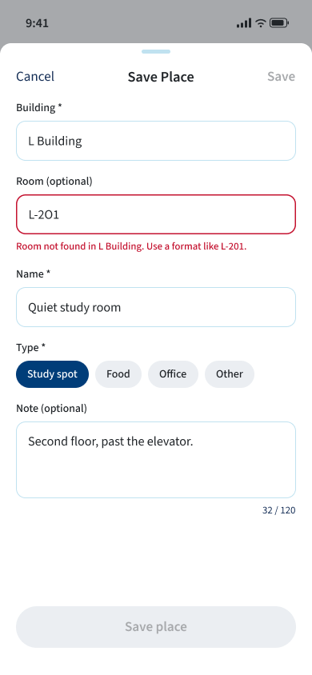
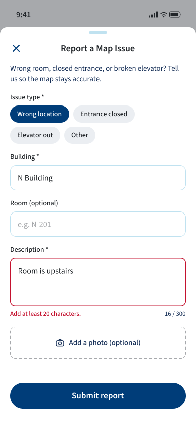

# App Wireframes & User Flow

## Tooling

Tooling: Figma

Figma link: [BC Maps Wireframes](https://www.figma.com/design/uKpzNeRSvQClWd1oo06RCQ)

## User Flow Diagram

user-flow.png: shows the tabs, pushed screens, modals, and dynamic routes.

## MVP Screen Wireframes

| Preview | Screen image | Route (file in the code) | Type |
|---|---|---|---|
|  | map.png | src/app/(tabs)/index.tsx | Tab |
|  | search.png | src/app/(tabs)/search.tsx | Tab |
|  | profile.png | src/app/(tabs)/profile.tsx | Tab |
|  | building-detail.png | src/app/building/[id].tsx | Pushed screen (dynamic route) |
|  | navigate.png | src/app/navigate/[roomId].tsx | Pushed screen (dynamic route) |
|  | save-place.png | src/app/place/new.tsx | Modal (form 1) |
|  | report-issue.png | src/app/report.tsx | Modal (form 2) |